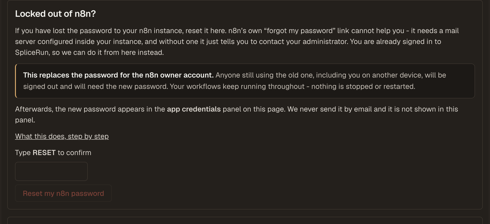

# Reset your n8n password

If you have lost the password to your n8n instance, you can reset it yourself from your SpliceRun
dashboard. You do not need to open a ticket, and your workflows keep running while you do it.

## Why n8n's own "forgot password" does not help

n8n's sign-in page has a **Forgot my password** link, and on a self-hosted instance it usually
leads nowhere. To send you a reset email, n8n needs an email server (SMTP) configured *inside* your
instance. Most instances do not have one, so instead of sending anything, n8n tells you to contact
your administrator.

On a self-hosted setup, you *are* the administrator. That is the dead end this page removes.

We can do it because you are already signed in to SpliceRun. Proving who you are is the hard part
of any password reset, and you have already done it by logging in here &mdash; so there is no email
for us to send, and nothing to configure.

## Before you start

Two things worth knowing, because neither is obvious:

- **Everyone using the old password gets signed out**, including you on your other devices, and
  including anyone on your team who shares that login. They will all need the new password.
- **Two-factor authentication is not removed.** If you switched on 2FA inside n8n, you will still
  need your authenticator app after the reset. A password reset only changes the password. If you
  have lost your 2FA device as well, [open a support ticket](https://app.splicerun.com/dashboard/support). That
  one we do have to handle by hand.

What does **not** happen: nothing stops, restarts, or is deleted. Your workflows, credentials,
executions, and schedules are untouched, and any workflow running at the moment you click the
button carries on running.

## Reset it

Go to **Instances**, open the instance you are locked out of, and scroll to **Locked out of n8n?**

1. Type `RESET` in the confirmation box. This is deliberate friction &mdash; it is the step that
   stops an accidental click from signing out your whole team.
2. Click **Reset my n8n password**.
3. Wait a few seconds. The panel tells you when it is done.
4. Open the **app credentials** panel on the same page. Your new password is there.

Then sign in to n8n with your usual email address and that new password.

We recommend changing it to something you choose, from inside n8n, once you are back in
(**Settings &rarr; Personal**).

## Where the new password appears, and where it does not

The new password is shown **only** in the app credentials panel on your instance page, and only to
signed-in team admins.

We do not email it to you. We do not show it in the reset panel itself, we do not put it in your
activity feed, and it is not written to any log. If someone gets a copy of a notification from us,
they still do not have your instance.

## Who can do this

A **team admin**. If you are a team member rather than an admin, the panel tells you so and the
button is disabled. Ask an admin on your team, or
[open a support ticket](https://app.splicerun.com/dashboard/support).

## Where you will not see the button

The panel hides itself when it cannot help, rather than failing after you click:

| Situation | Why | What to do instead |
|---|---|---|
| **Bring Your Own Server** | The instance runs on *your* machine, and this button does not reach into it | Reset it on your own server, or [open a support ticket](https://app.splicerun.com/dashboard/support) |
| **Other apps** | This button understands n8n's accounts only | [Open a support ticket](https://app.splicerun.com/dashboard/support) |
| The instance is still being set up | There is no app to sign in to yet | Wait for provisioning to finish |
| The instance is suspended or paused | The app is stopped, so there is nothing to sign in to | See the [Billing, Cancellation, and Data Policy](../../billing/cancellation-data-policy.md) for how to bring it back |

In every one of those cases you can still open a support ticket from your dashboard, but the free
plan doesn't include human support, so ticket replies are best-effort. See
[Getting help](../../troubleshooting/getting-help.md).

## If the reset fails

The panel says so, and **your old password is left exactly as it was**. Nothing is half-changed:
we check that the new password actually works before we report success, and if that check does not
pass we stop and change nothing. You can [open a support ticket](https://app.splicerun.com/dashboard/support),
but ticket replies are best-effort.

## Related

- [Managing your instance](../../account/managing-your-instance.md)
- [Account security](../../account/security.md)
- [What our monitoring can see](../../security/monitoring-what-we-can-see.md)
